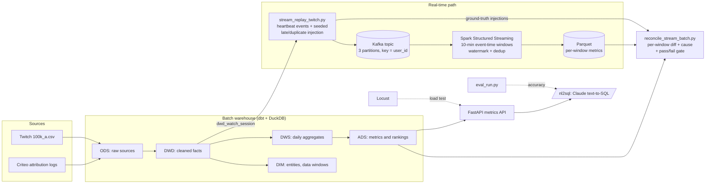

# live-dw: Live-Streaming and Ad Monetization Data Warehouse

An end-to-end data project on two public datasets (Twitch viewing records and Criteo display advertising logs):

- a layered **batch warehouse** in dbt + DuckDB (ODS → DWD → DIM/DWS → ADS) with 44 data tests,
- a **real-time pipeline** that replays viewing events through Kafka into Spark Structured Streaming and computes 10-minute concurrent viewers with an event-time watermark,
- a **stream-vs-batch reconciliation** that compares every real-time window with the offline metric and attributes each difference to a cause,
- a **metrics API** (FastAPI) load-tested with Locust, and a **text-to-SQL** endpoint (Claude) with a repeatable evaluation harness.

Every number below was measured in this repository; the raw outputs are committed under `results/` and `eval/`.

## Results at a glance

| Area | What was measured | Result |
| --- | --- | --- |
| Batch warehouse | `dbt build`, 15 models, 44 tests | rebuilds and tests in about 11 s on a laptop |
| Real-time vs offline (clean replay) | 1,008 ten-minute windows, 1,457,071 events | 1,008 / 1,008 windows identical to the dbt ADS table |
| Real-time vs offline (1% late, 0.5% duplicate events injected) | every differing window classified | 993 differing windows, all explained by late events beyond the watermark, 0 unexplained; all 7,318 duplicates removed |
| Watermark trade-off | 20 min vs 70 min watermark, same injected faults | late events dropped: 6,981 (0.479%) vs 0; median output lag 7.1 s vs 11.5 s of replay time |
| Metrics API | Locust, 50 users, 60 s, Apple M4 | connection reuse: 1,261 → 1,609 QPS, p95 26 → 11 ms |
| Text-to-SQL latency | 20 questions through the API | p50 1,051 ms end to end; 97.3% of request time is the LLM call, SQL execution p50 1.9 ms |
| Text-to-SQL accuracy | 24-question test set, 3 runs per round | 47.2% → 91.7% after exposing the ad schema; error taxonomy for every miss |

## Architecture



## Batch Warehouse

### Datasets

| Module | Dataset | Scope |
| --- | --- | --- |
| Live streaming | Twitch chat-presence records, 100k-user subset (Rappaz, McAuley and Aberer, RecSys 2021) | 6,148 ten-minute steps, about 43 days |
| Ad monetization | Criteo Attribution Modeling for Bidding dataset (Diemert, Meynet, Lefortier and Galland, AdKDD 2017) | 16,468,027 impressions, 6,142,256 users, 675 campaigns, 30-day sample |

Both datasets use relative time rather than calendar dates. The Criteo `cost` field is a transformed value released by Criteo, not the real price, so cost-based metrics are only meaningful for relative comparison. The Criteo dataset is licensed for non-commercial use (CC-BY-NC-SA 4.0).

Note on conversion counts: Criteo's dataset page reports about 45K conversions, but this figure could not be reproduced under the counting definitions examined in this project. The downloaded file contains 435,810 distinct valid conversion IDs and 438,730 distinct (conversion ID, user ID) pairs. Among the valid conversion IDs, 236,331 appear with attribution = 1, and 327,860 distinct users are associated with at least one conversion. The reason for the discrepancy remains unresolved.

Design rules applied across both modules:

- **Grain first.** Every model states its grain, and key assumptions are verified with SQL before modeling.
- **Additive measures in DWS, ratios in ADS.** Rates such as CTR and CVR are always computed from summed numerators and denominators, never averaged.
- **Window rules defined once.** Partial-day and data-maturity rules live in single-row `dim_*_data_window` tables that downstream models reference.
- **Flag, don't drop.** Suspect records are kept and labeled so downstream users can decide how to filter.

### Live-streaming models

| Layer | Model | Grain |
| --- | --- | --- |
| DWD | `dwd_watch_session` | one row per (user_id, stream_id) |
| DIM | `dim_user`, `dim_streamer` | one row per user / streamer |
| DIM | `dim_data_window` | single row: last step and last full day |
| DWS | `dws_user_day`, `dws_streamer_day` | one row per (entity, day) |
| ADS | `ads_platform_daily` | DAU, active streamers, PCU, sessions, watch time |
| ADS | `ads_platform_concurrency` | concurrent users per 10-minute step |
| ADS | `ads_user_retention` | D1 and D7 retention by cohort |

A viewer is a user present in a stream's chat, crawled every 10 minutes, not every person watching. Day 42 is partial, so daily metrics carry an `is_full_day` flag. Users first seen on day 0 are left-censored and excluded from retention cohorts. Every sampled user has at least 5 records, which suggests an activity filter in sampling, so later retention cohorts are biased upward.

### Ad monetization models

| Layer | Model | Grain |
| --- | --- | --- |
| DWD | `dwd_ad_impression` | one row per impression |
| DWD | `dwd_ad_conversion` | one row per conversion, keyed by (conversion_id, user_id) |
| DIM | `dim_ad_data_window` | single row: last full day and last mature day |
| DWS | `dws_ad_campaign_day` | one row per (campaign, day) |
| ADS | `ads_ad_daily` | one row per day: CTR, CVR, CPA, CPM, attribution rate |
| ADS | `ads_ad_campaign_performance` | one row per campaign, with CPA ranking and share of cost |

Conversions are credited to the day of the last click on the journey (click-date attribution), so clicks and conversions on the same row come from the same traffic.

### Findings from data validation

**1. The impression table has no ID, but a natural key exists.** (timestamp, uid, campaign) is unique across all 16.5 million rows and there are no duplicate rows, so `impression_id` is an md5 hash of those three columns.

**2. Missing values are encoded as -1, not NULL.** Column profiling reported 0% nulls, but five columns use -1 as a sentinel. These are converted to NULL in DWD so that averages and counts are not distorted.

**3. `conversion_id` is not unique: source ID collision.** 2,910 conversion IDs have rows that disagree on user and conversion time, and every cross-campaign and mixed-attribution anomaly came from this set. Regrouping by (conversion_id, user_id) removed all of them, so the conversion grain is (conversion_id, user_id): 438,730 conversions vs 435,810 distinct IDs. 5,830 affected conversions are flagged with `is_shared_conversion_id`.

**4. Conversion metrics are biased near the end of the observation window.** Daily CVR rose over the last few days. A campaign-mix explanation was rejected (506 of 667 campaigns saw their own CVR rise, median +28.1%); right truncation is supported (the average gap from last observed click to conversion grows from 4.01 days for day-0 clicks to 7.37 days for day-30 clicks). The fix is a configurable maturity window (`ad_maturity_days`, default 7): the 7 immature days show a CVR 13.8% higher than the 23 mature days, `ads_ad_daily` flags them, and campaign rankings use mature days only. The top 3 campaigns by CPA did not change after the correction.

Campaigns need at least 30 conversions (`ad_min_conversions_for_rank`) to receive a CPA rank. Both thresholds can be changed without editing SQL:

```bash
dbt build --vars '{ad_maturity_days: 5, ad_min_conversions_for_rank: 50}'
```

### Data quality

44 dbt data tests run on every build: uniqueness and not-null on every model key (including composite keys), referential integrity between DWS tables and dimensions, reconciliation tests that aggregated totals match the detail layer exactly, and range checks that CTR, CVR and attribution rate stay within [0, 1]. Exploratory validation scripts are kept in `scripts/` (`criteo_profile.py`, `criteo_check_grain.py`, `check_*.py`) so each modeling assumption traces back to the query that tested it.

## Real-Time Pipeline and Stream-vs-Batch Reconciliation

### What it does

1. **Replay** (`scripts/stream_replay_twitch.py`). Each `dwd_watch_session` row becomes one heartbeat event per 10-minute step it covers, which matches how the source data was collected. Days 10-16 (steps 1440-2447) give 1,457,071 events. Events are sent to Kafka in step order at 1 second per step (600x real time), keyed by `user_id`. Optional seeded fault injection holds back a share of events by 1-6 steps (late) or sends them twice (duplicates), and writes every injected event to a ground-truth CSV. A final flush marker moves the watermark past the last windows.
2. **Streaming job** (`scripts/stream_concurrency_spark.py`, Spark 4.2.0, `local[4]`). Reads the topic, assigns events to 10-minute tumbling event-time windows with a watermark, and writes three per-window metrics to Parquet in append mode: `sessions_online` (deduplicated by event id, the offline definition), `users_online` (distinct users) and `events_raw` (no dedup).
3. **Reconciliation** (`scripts/reconcile_stream_batch.py`). Joins every window with `ads_platform_concurrency` and a direct recomputation from DWD, labels each window (`match`, `late_beyond_watermark`, `duplicate_not_removed`, `window_not_emitted`, `unexplained`) using the ground truth, and exits non-zero if the match rate is below `--min-match-rate` or more than `--max-unexplained` windows cannot be attributed, so it can gate a pipeline.

### Runs

All runs: Kafka 4.3.1 (KRaft, local), topic with 3 partitions, Spark 4.2.0 with 4 cores, Apple M4 / 24 GB.

| Run | Injected faults | Watermark | Windows matching batch | Notes |
| --- | --- | --- | --- | --- |
| `clean2_d10_16` | none | 20 min | 1,008 / 1,008 | stream sum 1,457,071 = batch sum |
| `faulty2_d10_16` | 14,554 late (1%, 1-6 steps), 7,318 duplicates (0.5%) | 20 min | 15 / 1,008 | 993 windows `late_beyond_watermark`, 0 unexplained, 0 windows above batch |
| `wm70_d10_16` | same as faulty2 (same seed) | 70 min | 1,008 / 1,008 | 0 late events dropped, all duplicates removed |

Per-window difference distribution for `faulty2`: 15 windows differ by 0 events, 425 by 1-5, 564 by 6-20 and 4 by more than 20. The total difference is 6,981 events, 0.479% of the batch total.

### Findings

- **The two streaming paths drop different late events.** With the 20-minute watermark, the deduplicated path lost 6,981 late events and the raw path lost 4,731. In every window, the deduplicated path's shortfall is covered by late events delayed 4 or more steps, while the raw path's is covered by events delayed 3 or more steps and mostly by 5-6 steps. This is consistent with Spark's semantics: the dedup operator drops an event once its event time is behind the watermark, while the window aggregation waits until the whole window end is behind it, one 10-minute window later. (This is a per-window bound, not a per-event trace.)
- **Watermark is a latency-vs-completeness knob.** Raising it from 20 to 70 minutes (above the 60-minute maximum injected delay) removed all late-event drops, and raised the median time from "window's events sent" to "window written" from 7.1 s to 11.5 s of replay time (p95 9.3 s to 13.1 s), where 1 s of replay is one 10-minute step. The lag is measured from Parquet file times (`scripts/emission_lag.py`), so it is approximate.
- **Users vs sessions is a definition gap, not an error.** Counting distinct users instead of (user, stream) sessions lowers the 7-day total by 54,706, and the streaming `users_online` matched the batch distinct-user count in all 1,008 windows of the clean run.

### Problems hit along the way

- **Kafka retention deleted the data.** The first clean run set the Kafka record timestamp to the historical event time (January 2026). Kafka's 7-day time-based retention uses the record timestamp, so the data was deleted almost immediately and Spark failed with a data-loss error. Fix: keep event time in the payload and let Kafka stamp produce time. The run `clean_d10_16` is invalid and kept only as a record.
- **The laptop slept mid-run.** The first faulty run (`faulty_d10_16`) stopped when the Mac slept (a 957 s gap between Spark commits). Later runs used `caffeinate`.
- **Backfilling from Kafka with a fixed batch size broke the watermark.** Re-reading the same topic at 1,450 records per micro-batch dropped 209,898 events (14.4%), and only 2 of 1,008 windows matched. `maxOffsetsPerTrigger` splits each batch across partitions by remaining offsets, not by event time, so the partitions drifted apart in event time (median span of 9 steps per batch, vs at most 1 step in the real-time run) and Spark's single global watermark dropped on-time events from the lagging partitions. The real-time re-run (`faulty2`) fixed it. The failed outputs are kept under `results/stream/*faulty_d10_16*`.

## Metrics API and Load Test

`api/app.py` serves the ADS layer over HTTP (FastAPI + DuckDB, read-only):

| Endpoint | Returns |
| --- | --- |
| `GET /metrics/live/concurrency?start_step=&end_step=` | 10-minute concurrent viewers |
| `GET /metrics/live/daily?day_index=` | DAU, PCU, sessions, watch time |
| `GET /metrics/ads/daily?day_index=` | CTR, CVR, CPA, CPM per day |
| `GET /metrics/ads/campaign/{campaign_id}` | one campaign's performance and CPA rank |
| `POST /nl2sql` | generated SQL, result rows and an LLM vs execution timing split |

Two environment switches make before/after comparisons possible with the same code: `DB_MODE=per_request|shared` and `CACHE=0|1`.

**Load test** (`loadtest/locustfile.py`, `loadtest/run.sh`): 50 concurrent users for 60 s, endpoints weighted 4:2:2:2 with random parameters from real key ranges. Machine: Apple M4, 10 cores, 24 GB, macOS 15.7.9; one uvicorn process; Locust on the same machine. 0 failed requests in every round.

| Round | Setting | QPS | p50 | p95 | p99 |
| --- | --- | --- | --- | --- | --- |
| r1 | new DuckDB connection per request (baseline) | 1,261 | 11 ms | 26 ms | 55 ms |
| r2 | one shared connection, a cursor per request | 1,609 | 3 ms | 11 ms | 29 ms |
| r3 | r2 + in-memory LRU cache | 1,680 | 2 ms | 12 ms | 29 ms |
| r4 | `GET /health`, no database at all (ceiling check) | 1,829 | 1 ms | 1 ms | 10 ms |

- The baseline bottleneck was opening and closing a DuckDB connection on every request; reusing one connection raised throughput by 27.6% and cut p95 from 26 to 11 ms.
- Caching added only 4.4% more QPS and did not improve p95, because the ADS tables are small and queries already take a few milliseconds.
- An endpoint that does no work tops out at 1,829 QPS, so the next limit is the single Python web process, not the database. Running several uvicorn workers (each with its own read-only connection) is the next step and was not done here. Locust ran in one process on the same machine and reported no CPU warnings, but its share of the ceiling cannot be fully ruled out.

**Text-to-SQL latency** (`loadtest/nl2sql_latency.py`, 20 gold questions, one at a time): end-to-end p50 1,051 ms / p95 1,735 ms; LLM call p50 1,049 ms; SQL execution p50 1.9 ms / p95 7.4 ms. The LLM call is 97.3% of total request time, which is why `/nl2sql` is measured for latency rather than load-tested for QPS.

## Text-to-SQL and Evaluation

`scripts/nl2sql.py` builds a prompt from DuckDB column types plus dbt column descriptions, asks Claude (Haiku 4.5, `claude-haiku-4-5-20251001`) for one read-only query, retries once with the error message if execution fails, and enforces read-only access twice (a SELECT/WITH-only check and a read-only database connection).

### How accuracy is defined (`scripts/eval_run.py`)

- **Execution accuracy (relaxed):** the predicted SQL returns the same number of rows as the gold SQL, and every gold column's values (order-insensitive, numbers within a relative tolerance of 1e-4) match some predicted column. Extra predicted columns are allowed.
- **Strict:** relaxed, plus the same number of columns.
- Each round runs every question 3 times at the model's default temperature and reports mean, min and max accuracy, plus how many questions were correct in all 3 runs.
- The first harness rounded floats to 2 decimals, which would have accepted the average of daily CTRs (0.3619) as the overall CTR (0.3612). The tolerance fixes that; re-scoring the earlier results with it changed none of them.

### Error taxonomy

Every miss gets one label, assigned by comparing the predicted and gold SQL with sqlglot: `no_sql_returned`, `multi_statement`, `rejected`, `schema_not_exposed`, `exec_error`, `missing_flag_filter`, `extra_flag_filter`, `wrong_table`, `aggregation`, `row_count`, `value_mismatch`. The labels are heuristics; the per-question details keep both queries for review.

### Rounds

Test set `eval/test_v2.json`: 24 questions (12 live streaming, 12 ad monetization) with joins, ratio-of-sums traps and business-flag filters. Gold SQL was run and checked for ties.

| Round | Change | Accuracy (mean, min-max of 3 runs) | Correct in all 3 runs | Errors |
| --- | --- | --- | --- | --- |
| r1 | existing system (live tables only) | 47.2% (45.8-50.0%) | 11 / 24 | `no_sql_returned` 36, `multi_statement` 1, `row_count` 1 |
| r2 | add the 4 ad tables to the prompt schema | 91.7% (91.7-91.7%) | 22 / 24 | `multi_statement` 3, `extra_flag_filter` 3 |
| r3 | r2 + 3 business rules (`eval/rules_v3.txt`) | 91.7% (87.5-95.8%) | 20 / 24 | `multi_statement` 2, `row_count` 2, `wrong_table` 2 |

- **r1:** every ad question failed, but in a useful way. In all 36 cases the model answered in prose that no ad table existed instead of inventing one.
- **r2 → r3:** the rules fixed the targeted error (overall CTR went from 0/3 to 3/3 once the model stopped applying the full-day filter to whole-period totals), but three other questions each failed once more, so mean accuracy did not move. With 24 questions, one question is 4.2 points, and r3's range contains r2's score, so r3 is not a measurable improvement overall. `t10` ("users active on both day 0 and day 42") stayed wrong: the model intersects two counts instead of two user sets, a logic error that a prompt rule did not fix.
- **Caveats:** the rules were written after reading test_v2 failures, so from r3 on test_v2 acts as a development set. One r3 miss (`a06`, share of total cost) is partly a question ambiguity: the gold uses mature days only, the model used all days. As a regression check, the r3 configuration scored 20/20 on the original gold set and 8/8 on the original holdout in all 3 runs.
- Earlier results on the original 20-question gold set (20/20 in each of 3 runs) and the 8-question holdout (7/8) are kept in `eval/results_*.csv`. The original questions are single-table lookups, which is why the harder test set was added.

Every round is logged in `eval/runs_log.csv` with the model, question set, prompt hash and git commit; per-question results are in `eval/runs/`.

## How This Was Built: AI Agent Collaboration

This project was built with an AI coding agent (Anthropic's Claude) in conversation. Most of the code was drafted by the agent. My part was setting the goals and requirements, running every step on my own machine, checking results against independent queries, deciding what to keep, and debugging with the agent when runs failed. The step-by-step record, with how each result was verified, is in [`docs/ai_collaboration_log.md`](docs/ai_collaboration_log.md).

| | AI agent | Me |
| --- | --- | --- |
| Planning | proposed the module order, Spark vs Flink trade-off and the heartbeat replay design | set the scope from two target job descriptions and the "measured numbers only" rule; approved the design |
| Streaming | wrote the replay, Spark job and reconciliation scripts | installed Kafka, ran every replay and Spark job, kept failed runs as evidence |
| Debugging | diagnosed the Kafka retention bug, the flush marker being filtered below the watermark, the backfill watermark skew, the port race in the load-test script | noticed and reported failures, confirmed each diagnosis (e.g. offsets with `kafka-get-offsets`), re-ran |
| API and load test | wrote the API, Locust files and run script | installed dependencies, recorded machine specs, ran all rounds |
| Evaluation | wrote the test set and harness, proposed the rule changes | reviewed the questions, ran all rounds and regression checks |
| Verification | — | checked counts against independent queries (e.g. replay source count vs a dbt query, Kafka offsets vs events sent) |

## How to Run

Requirements: Python 3.13 and the packages in `requirements.txt`; Java 17 for Spark; Kafka (`brew install kafka`) for the streaming part.

```bash
python -m venv .venv && source .venv/bin/activate
pip install -r requirements.txt
```

**Data.** Criteo: download `criteo_attribution_dataset.tsv.gz` from the [Hugging Face dataset page](https://huggingface.co/datasets/criteo/criteo-attribution-dataset) into `data/raw/criteo/` and run `python scripts/criteo_profile.py`. Twitch: download `100k_a.csv` from the Twitch folder linked on the [UCSD McAuley Lab dataset page](https://cseweb.ucsd.edu/~jmcauley/datasets.html) into `data/raw/` and run `python scripts/explore.py`.

**Batch warehouse**

```bash
dbt build
```

**Streaming + reconciliation** (two terminals; the Spark job first)

```bash
brew services start kafka
kafka-topics --bootstrap-server localhost:9092 --create --topic twitch_hb_faulty2 --partitions 3 --replication-factor 1
caffeinate -i python scripts/stream_concurrency_spark.py --topic twitch_hb_faulty2 --run-id faulty2_d10_16 --idle-sec 120
caffeinate -i python scripts/stream_replay_twitch.py --start-day 10 --end-day 16 --topic twitch_hb_faulty2 \
    --run-id faulty2_d10_16 --step-seconds 1 --late-rate 0.01 --dup-rate 0.005
python scripts/reconcile_stream_batch.py --run-id faulty2_d10_16 --min-match-rate 0 --max-unexplained 0
```

**API and load test**

```bash
bash loadtest/run.sh r2_shared shared 0          # label, DB_MODE, CACHE
DB_MODE=shared python -m uvicorn api.app:app --port 8000
```

**Text-to-SQL evaluation** (needs `ANTHROPIC_API_KEY`)

```bash
python scripts/eval_run.py --set eval/test_v2.json --label my_round --runs 3 --retry --expose-ads
```

## Limitations

- Criteo cost is transformed and its CTR is far above typical display advertising, likely due to how the sample was built; comparisons across campaigns and days are the focus, not absolute values.
- The 7-day maturity window is a heuristic based on where daily CVR departs from its stable range.
- The streaming results come from a single machine and a 600x replay of 7 days; they show correctness and attribution, not production throughput.
- The text-to-SQL test set has 24 questions, so differences of one or two questions are within run-to-run variation.

## Next Steps

- Run the API with several uvicorn workers and a multi-process Locust to find the next ceiling.
- Stream the Criteo events through the same Kafka/Spark path and reconcile minute-level CTR against `ads_ad_daily`.
- Schedule the dbt build, streaming job and reconciliation gate with Airflow.
- Convert `dwd_ad_impression`, the largest model, to an incremental model.

## Project Structure

```
live-dw/
├── models/             dbt models: dwd/, dim/, dws/, ads/, plus sources.yml and schema.yml
├── tests/              custom dbt data tests (reconciliation, composite keys, ranges)
├── scripts/            profiling and validation, streaming replay, Spark job, reconciliation,
│                       text-to-SQL and evaluation
├── api/                FastAPI metrics API
├── loadtest/           Locust files, run script, text-to-SQL latency script
├── eval/               question sets, rules, per-round results and runs log
├── results/stream/     replay, Spark and reconciliation outputs for every run
├── results/api/        load-test outputs and machine specs
├── docs/               AI collaboration log
├── dbt_project.yml
├── profiles.yml
└── requirements.txt
```
